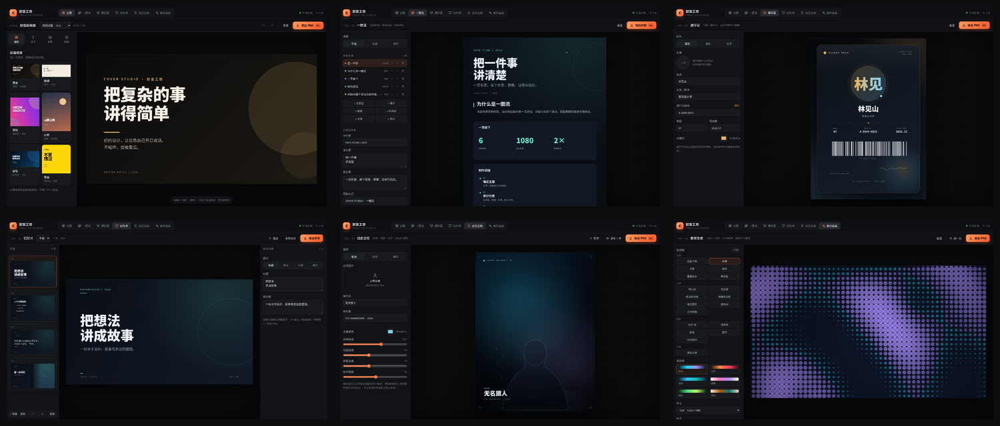
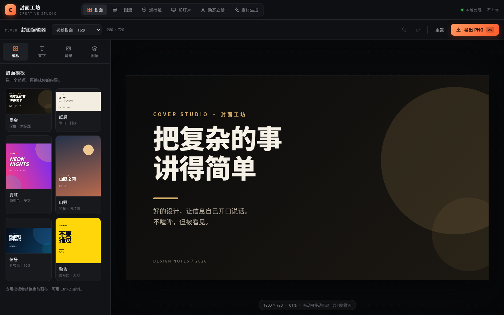
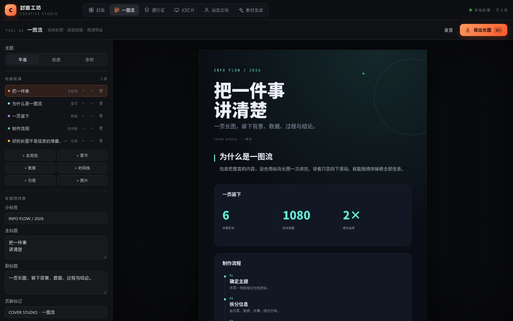
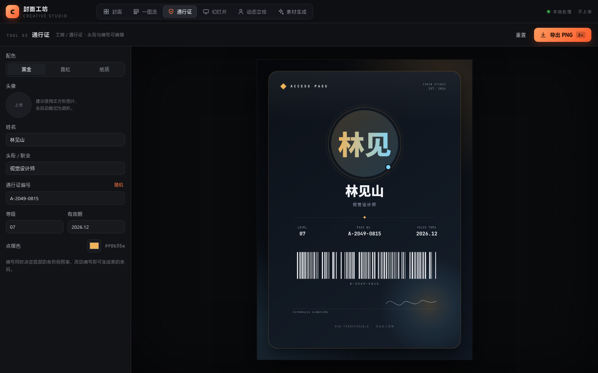
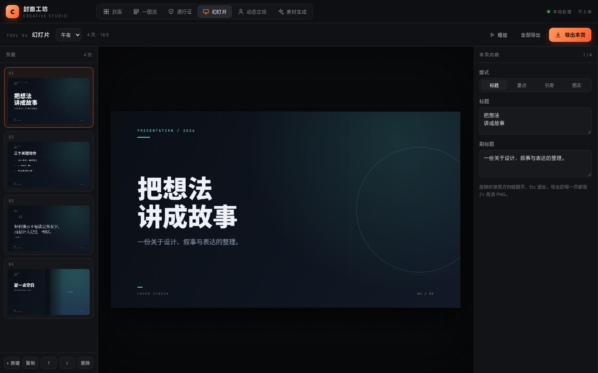
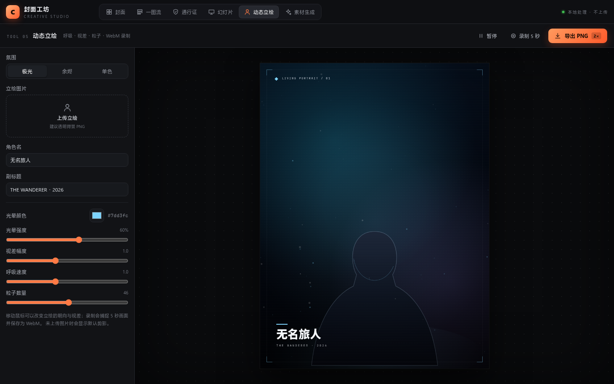
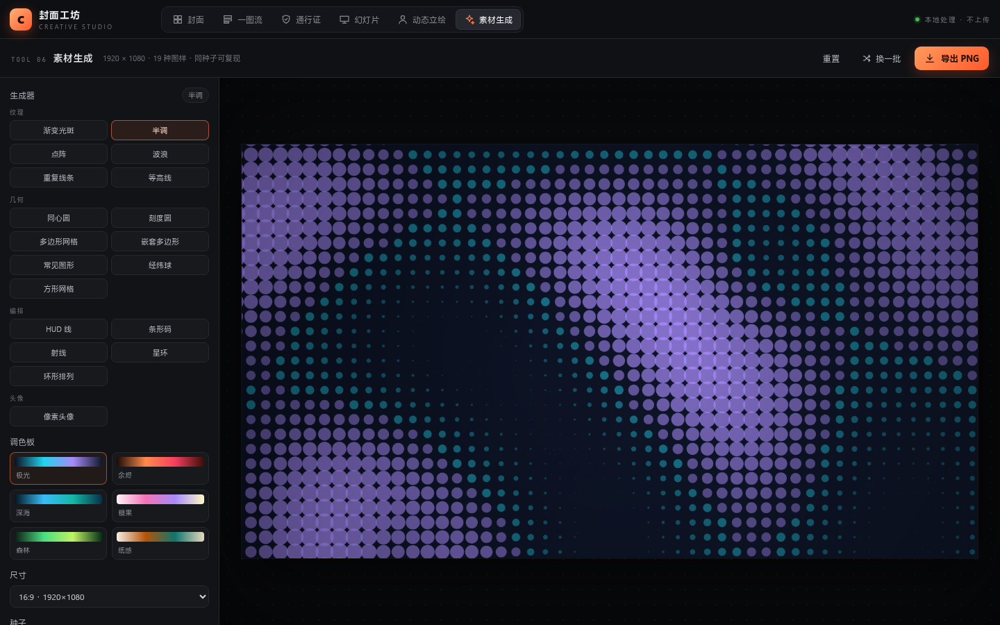

# 封面工坊 · Cover Studio

一个纯前端的多工具视觉工作台：**封面、一图流、通行证、幻灯片、动态立绘、素材生成**。
所有处理都在浏览器里完成，图片不上传服务器，不走后端。





## 六个工具

| 工具 | 能做什么 | 导出 |
| --- | --- | --- |
| **封面** | 6 套模板、文字排版、纯色/渐变/图片背景、图层管理、拖拽定位 | 2× PNG |
| **一图流** | 主视觉 / 章节 / 数据 / 时间线 / 引用 / 图片六类区块，自动测量高度，3 套主题 | 2× PNG |
| **通行证** | 头像、姓名、头衔、编号、等级、有效期、条形码、签名区，3 套配色 | 2× PNG |
| **幻灯片** | 4 种版式、多页管理、实时缩略图、全屏放映、单页/全部导出 | 2× PNG |
| **动态立绘** | 上传透明立绘，呼吸、视差、粒子、光晕、鼠标跟随，录制 5 秒视频 | PNG / WebM |
| **素材生成** | 19 种程序化图样，密度/角度/颗粒可调，种子可复现，9 套调色板（含黑白灰） | PNG / SVG |
| **UI 组件库** | 收录项目 demo 与 UI 模块拆分说明：Rhine Music · Windows、Endfield UI、NASA-Punk UI Skill、AUREOLE、p5-ui | — |

### 一图流



### 通行证



### 幻灯片



### 动态立绘



### 素材生成



## 技术栈

- Vue 3 + TypeScript
- Vite 6
- Canvas 2D 手写渲染（预览与导出共用同一套绘制逻辑，所见即所得）
- 零 UI 组件库、零外部图片素材、零网络字体

## 启动

```bash
npm install
npm run dev
```

打开 http://127.0.0.1:5173/ 。

生产构建：

```bash
npm run build
npm run preview
```

## 细节说明

### 封面

- 尺寸：公众号首图 2.35:1、视频封面 16:9、全高清、方形 1:1、竖版 3:4，可自定义
- 文字：中英文自动折行、7 组字体栈、字重、斜体、行高、字距、对齐、阴影、高亮底色
- 背景：纯色、双色渐变（角度可调）、本地图片（填满/完整、模糊、暗化）
- 图层：显示隐藏、上移下移、复制、删除、不透明度、精确坐标
- 画布：点击选中、拖拽移动、Shift 单轴锁定、方向键微调
- 撤销 / 重做保留最近 60 步

### 一图流

- 区块增删、上下移动，内容改变时画布高度自动重算
- 主题「午夜 / 纸感 / 余烬」会切换整套字体与配色
- 图片区块支持本地图片，导出前会预加载图片，避免空白

### 通行证

- 编号决定底部条形码的图案，点「随机」可生成新编号与新条码
- 头像自动圆形裁切，未上传时用姓名首字生成渐变头像
- 点缀色可单独调整，条形码、圆环、签名笔迹会同步换色

### 幻灯片

- 4 种版式：标题、要点、引用、图文
- 左侧实时缩略图，右侧编辑器；主题切换立即应用到全部页面
- 放映模式：方向键 / 空格翻页，Esc 退出，点击画面也可翻页
- 「全部导出」会依次下载每一页 PNG（浏览器可能会请求多文件下载权限）

### 动态立绘

- 建议上传**透明背景 PNG**；未上传时显示默认剪影
- 鼠标移动产生视差与轻微旋转，呼吸与漂浮持续播放
- 录制使用 `canvas.captureStream()` + `MediaRecorder`，固定录 5 秒并保存 WebM（Chrome / Edge 支持最好）

### 素材生成

- 19 种生成器，全部由 Canvas 程序化绘制，不依赖外部素材：
  - 纹理：渐变光斑、半调、点阵、波浪、重复线条、等高线
  - 几何：同心圆、刻度圆、多边形网格、嵌套多边形、常见图形、经纬球、方形网格
  - 编排：HUD 线、条形码、射线、星环、环形排列
  - 头像：像素头像
- 每种图样都有独立参数：如半调网点大小、波浪振幅/频率、刻度圆半径/主刻度长度、网格抖动、嵌套边数、经纬球半径/倾斜、条形码宽高、星环半径/星星大小等
- 统一参数：密度 / 旋转角度 / 颗粒质感 / 调色板 / 尺寸，同一组参数可完全复现
- 调色板含 **黑白、白底黑、灰阶** 三套无彩配色，也保留原有彩色配色
- 每种图样都有独立参数面板：半径、数量、角度、线宽、线型、颜色，条形码宽高、经纬球长短轴与经纬线、网格间距与填充、HUD 线条/角标/标签、3D 地形视角与雕刻等
- 交互式编辑：点阵可点击/拖动增删、连续擦除、清空填满随机；常见图形可选用圆形/方形/三角/菱形/十字/圆弧笔刷在网格上绘制；方形网格可逐格填充与擦除
- 3D 等高线地形：程序化高度场 + marching squares，拖动旋转、Shift 拖动雕刻、Alt 降低，层数/高度/缩放/雕刻强度可调
- 自定义素材：点阵支持自定义点形状与轮廓图片（按透明度决定点的显隐），星环支持自定义星形，常见图形支持自定义图形笔刷；导出 SVG 时图片以 `<symbol>` 去重内嵌
- 等高线支持带状填充：纯色 / 点阵 / 斜线，透明度与颜色可调
- HUD 线提供角标 / 方括号 / 虚线 / 无边框四种风格，线条箭头大小可调
- 所有图样支持「导出 SVG」：真正的矢量路径；支持 1×/2×/3× PNG 导出
- 选择像素头像时自动切到 1:1 画布；预览按比例降采样，导出仍按原始尺寸
- 已通过 19 种生成器逐一渲染的无头浏览器冒烟测试，控制台无报错

## 收录的本地 Demo：Rhine Music · Windows

UI 组件库首个收录项目：[Bong712/Rhine-Music-Windows](https://github.com/Bong712/Rhine-Music-Windows)，Rhine Music 的 Windows 桌面移植版，界面基础来自 [RonaldDeng/Rhine-Music-Demo](https://github.com/RonaldDeng/Rhine-Music-Demo) 与 [LBEILC/RhineLabUI](https://github.com/LBEILC/RhineLabUI)。

- 源码目录：`demos/rhine-music-windows`（MIT License，维护者 Bong712；保留原 LICENSE、NOTICE 与 THIRD-PARTY-NOTICES）
- 相比上游增加：同步 LRC 歌词、歌单、可编辑播放队列、封面图集与实例化绘制
- 组件库内嵌演示：`/rhine-mock.html`（本项目原创静态 mock，5 张本地封面，无 WebGL、无后端）
- 真实 Windows 前端仍可本地运行（可选）：`cd demos/rhine-music-windows && npm install && npm run build && npm run music -- --port 5175`，然后打开 http://127.0.0.1:5175/?demo=1
- 静态 mock 不需要 Node/WebGL；真实前端需要 Node.js ≥ 22.12、WebGL 2，`?demo=1` 会跳过音频与曲库扫描
- 静态 mock 的专辑、曲目、封面均为示例数据，不复用项目素材
- 真实前端的 3D 封面纹理在部分 GPU/驱动上会显示为空白；因此站内演示改用静态 mock，避免依赖 WebGL 贴图
- 界面模块拆分与使用说明见「UI 组件库」；非代码素材（模型、字体、截图等）的版权与许可见项目内 `NOTICE.md`，不属于 MIT 授权范围

本项目只在本地克隆并运行该 Demo 用于组件库展示，没有把它打包进主站构建。

## 收录的在线 Demo：Endfield UI

第二个收录项目：[icaruszezen/endfield-ui](https://github.com/icaruszezen/endfield-ui)，《明日方舟：终末地》设计风格文档与 React + Tailwind CSS v4 组件库。

- 仓库：https://github.com/icaruszezen/endfield-ui （MIT）
- 在线预览：https://icaruszezen.github.io/endfield-ui/ （Storybook，已在 UI 组件库内嵌）
- 设计文档：https://icaruszezen.github.io/endfield-ui/design/
- npm：`@endfield-ui/react`
- 组件库主入口不包含官方素材；「Game 实机风格」独立入口约 30 张官方图片不在 MIT 范围内，使用前请阅读项目 `NOTICE.md` 与风险说明
- UI 组件库内按「设计基础与主题 / 基础控件 / 表单控件 / 反馈与浮层 / 展示与导航 / 母题与动效」六组拆解，每组都有视觉 Demo；母题与动效页的 Demo 会播放镂空字擦除、角括号展开、刻度环点亮与斜纹位移，并可点「重播动效」重看

## 收录项目注意事项

第三方项目的许可、署名、素材边界、Demo 运行方式与新增项目检查清单，统一整理在：

**[docs/COLLECTED-PROJECTS.md](docs/COLLECTED-PROJECTS.md)**

要点：代码许可不等于素材许可；保留原作者与上游署名；官方模型、字体、截图、音频不随 MIT 授权；不宣称官方关系；本地 Demo 只绑定 127.0.0.1；权利人异议时立即下架相关素材。

## 中英双语与组件 Demo 动效

- 语言默认跟随系统：`navigator.language` 以 `zh` 开头显示中文，其余显示英文；右上角 `EN / 中` 可切换，选择会记在 `localStorage`。
- 当前覆盖全站导航、UI 组件库的项目 / 模块说明、Demo 文案、运行说明与 AI 上下文；其他工具页暂时保留中文。
- 每个模块的视觉 Demo 右上角都有「重播 / Replay」；滚动进入视口时也会自动重播一次，方便直接看到动效。
- 支持 `prefers-reduced-motion`：系统开启减少动态效果时，Demo 停在终态。
- 模块里的视觉 Demo 是原创交互示意，不是项目截图；每个 Demo 下方有「打开真实 Demo」链接，避免把示意图误认为原项目界面。

## 给 AI / Agent 的组件索引

- 路由规则：`#/ui/{project}/{module}`，例如 `#/ui/endfield-ui/ef-controls`。
- 每个模块详情里有 **AI CONTEXT** 区块，包含 route、project、module、源码文件、Demo 地址、许可与安装信息，可一键复制。
- 机器可读目录：[/ui-catalog.json](/ui-catalog.json)，列出两个项目的 id、仓库、Demo、包名与全部模块路由。
- 页面根节点带 `data-project` / `data-module`，便于解析当前组件。

## 收录的设计系统技能：NASA-Punk UI Skill

第三个收录项目：[duanth/NASA-Punk-UI-SKILL](https://github.com/duanth/NASA-Punk-UI-SKILL)，面向 AI 编码智能体的 NASA 黄金时代复古未来主义设计系统。

- 仓库：https://github.com/duanth/NASA-Punk-UI-SKILL （MIT）
- 参考实现：/nasa-punk-reference.html （仓库自带的零依赖单文件 HTML，已本地托管）
- 设计规范：`SKILL.md`
- 三种表面：印刷文档（默认）、控制台仪表、时代色调（水星 / 双子 / 阿波罗）
- 内部分为「基础表皮与字体 / 印刷文档层 / 控制台仪表 / 图表语法 / 运动与质量门 / 时代色调与纹章」六组，每组都有视觉 Demo
- 许可注意：代码为 MIT；NASA 徽记与标志是美国政府商标，仓库只使用虚构的受启发品牌，本站也不使用官方徽记

## 收录的交互模板：AUREOLE · Sixth UI

第四个收录项目：[AlphaZero78/ArknightsSixthUI](https://github.com/AlphaZero78/ArknightsSixthUI)，从《明日方舟》六周年 PV 前 60 秒提取的交互模板。

- 仓库：https://github.com/AlphaZero78/ArknightsSixthUI （MIT）
- 本地 Demo：http://127.0.0.1:5176/
- 设计来源：`docs/SOURCE-STUDY.md`，逐段记录前 60 秒的视觉锚点
- 三种观测模式：实体观测、结构透视、解构重组
- 内部按「实体观测 / 结构透视 / 解构重组 / 漂浮场景与投影 / 标注搜索与档案 / 配置与无障碍」六组拆解，每组都有视觉 Demo
- 素材说明：演示主体为独立生成图片；字体为 OFL；项目为非官方模板，与鹰角网络无关

## 收录的社区组件库：p5-ui

第五个收录项目：[q-mona/p5-ui](https://github.com/q-mona/p5-ui)，Vue 3 的 Persona 5 风格玩具组件库。

- 仓库：https://github.com/q-mona/p5-ui
- **仓库未提供 LICENSE，默认保留所有权利**；本站只做链接索引与本地评估，不复制其代码、图片、字体或构建产物
- 本地文档站：http://127.0.0.1:5177/ （仅在本机运行，不随本站发布）
- npm 包：`p5-ui`
- 内部分为「全局样式与图标 / 按钮标题文字 / 滑块开关 / 消息通知返回顶部 / 分隔上传表格 / 人群动画」六组
- 视觉 Demo 与封面为本站原创 CSS/SVG 重绘，不使用项目素材；如权利人提出异议会立即下架

## Docker 部署

仓库根目录提供 `docker-compose.yml`：`builder` 容器从 GitHub 克隆私有仓库并构建，`web` 容器用 nginx 托管；builder 成功退出后 web 才启动。

前置：Docker + Docker Compose，以及一个有 `Contents: read` 权限的 GitHub token（仓库是私有的）。

```sh
cp .env.example .env
# 编辑 .env，填入 GITHUB_TOKEN

docker compose up -d
# 打开 http://localhost:8080
```

也可以不建 `.env`，直接：

```sh
export GITHUB_TOKEN=github_pat_xxx
PORT=8080 docker compose up -d
```

### Token 放在哪里

可以放在项目根目录的 `.env`，Compose 会自动读取并传给 `builder`；该文件已加入 `.gitignore`。

```sh
cp .env.example .env
chmod 600 .env
# 编辑 .env，填入 GITHUB_TOKEN
```

不要把 token 直接写进 `docker-compose.yml`、README、源码或提交历史。**私有仓库不等于安全边界**：协作者、CI、备份、fork 和 Git 历史都可能暴露它。

建议：

- 使用 fine-grained PAT，只授权 `hhdtc/cover-studio`，权限仅 `Contents: read`，并设置过期时间
- token 只保存在本机 `.env`，权限设为 `600`
- 一旦误提交，立即到 GitHub 撤销并轮换 token；只删除提交不能清除历史
- 当前方案把 token 作为 builder 容器环境变量，容器存在期间本机 root 可通过 `docker inspect` 看到；多用户主机建议改用 Docker secret / BuildKit 或只读 deploy key

常用命令：

```sh
docker compose logs -f builder      # 查看克隆与构建日志
docker compose ps                   # 查看状态
docker compose up -d --force-recreate   # 重新拉取 main 并重建
docker compose down                 # 停止；加 -v 同时删除构建卷
```

可选变量（见 `.env.example`）：

- `REPO_URL`：默认 `https://github.com/hhdtc/cover-studio.git`
- `REPO_REF`：默认 `main`，可填分支或 tag
- `PORT`：宿主机端口，默认 `8080`

说明：

- token 只注入 `builder` 容器，不写入最终 nginx 镜像；`.env` 已加入 `.gitignore`。
- 更新流程是重新运行 builder：`docker compose up -d --force-recreate`，或 `docker compose run --rm builder && docker compose restart web`。
- UI 组件库里的 5176 / 5177 是独立本地 Demo，不在这个容器里；需要时在宿主机单独启动。Rhine 的静态 mock 与 NASA-Punk 参考页随主站一起打包，可直接使用。

## 顶部导航

主导航为 **UI 组件库** 与 **素材生成**；封面、一图流、通行证、幻灯片、动态立绘收在 **「其他」** 二级菜单中。直接打开对应路由仍会正确切换到该工具。

## 页面路由

每个工具都有独立的 hash 路由，地址栏可直接复制给他人或用于精确引用：

| 工具 | 路由 |
| --- | --- |
| 封面 | `#/cover` |
| 一图流 | `#/flow` |
| 通行证 | `#/pass` |
| 幻灯片 | `#/slides` |
| 动态立绘 | `#/portrait` |
| 素材生成 | `#/assets` |
| UI 组件库 | `#/ui` |

例如：`http://127.0.0.1:5173/#/assets`。右上角会显示当前路由，点击即可复制完整链接；浏览器前进/后退也能正常切换。

UI 组件库还带项目与模块子路由：`#/ui/rhine-music`、`#/ui/rhine-music/shelf`、`#/ui/rhine-music/lyrics` 等。每个模块都有独立的视觉 Demo，可直接分享到具体组件；例如 `#/ui/rhine-music/navhud` 的底部导航层包含序号滚动、专辑列横移、流派淡入和 ENTER 打开专辑的过渡，`#/ui/nasa-punk/nasa-console` 则是控制台仪表与扫描单目镜。

## 快捷键

| 快捷键 | 功能 |
| --- | --- |
| `Ctrl/⌘ + Z` | 封面：撤销 |
| `Ctrl/⌘ + Shift + Z` / `Ctrl/⌘ + Y` | 封面：重做 |
| `Ctrl/⌘ + D` | 封面：复制选中图层 |
| `Delete` / `Backspace` | 封面：删除选中图层 |
| `↑ ↓ ← →` | 封面：移动 1px（Shift 为 10px）；幻灯片：切换页面 |
| `Esc` | 封面：取消选中；放映：退出 |

## 目录结构

```
src/
  App.vue               工具壳：品牌区、六个工具导航、KeepAlive
  views/
    CoverView.vue       封面编辑器
    InfographicView.vue 一图流
    PassView.vue        通行证
    SlidesView.vue      幻灯片
    PortraitView.vue    动态立绘
    AssetsView.vue      素材生成
    UILibraryView.vue   UI 组件库
  components/
    StageCanvas.vue     封面画布：缩放、选中框、拖拽命中
    TemplateCard.vue    模板缩略图
    SlideThumb.vue      幻灯片缩略图
    ToastHost.vue       全局轻提示
    Icon.vue            内联 SVG 图标
  lib/
    draw.ts             Canvas 通用绘制 / 导出 / 随机数工具
    slides.ts           幻灯片版式与主题渲染
    useCanvasPreview.ts 响应式预览画布
    toast.ts            轻提示状态
  render.ts             封面渲染与导出
  store.ts              封面状态、图层操作、撤销栈
  templates.ts          封面模板
  types.ts              封面文档 / 图层类型
  fonts.ts              字体栈与字重
  style.css             全局样式
```

## 说明

- 界面、模板、文案与代码均为本项目原创；没有复制或打包任何第三方站点素材。
- 文字使用系统字体栈（思源黑体 / 苹方 / 宋体 / 楷体 / Noto CJK 等），不同系统上字形会有差异。
- 图片通过 `FileReader` 读成 data URL，仅存在于当前页面内存中，刷新即清空。
- 导出的 PNG 多为 2× 分辨率：封面 2560×1440、通行证 1800×2520、幻灯片 2560×1440、长图按内容高度输出。
- 建议使用最新版 Chrome / Edge，录制与多文件下载的兼容性最好。
